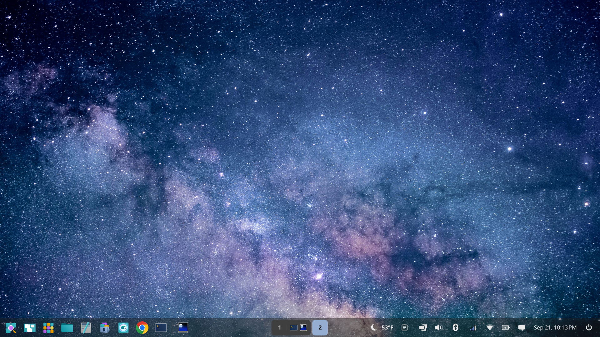
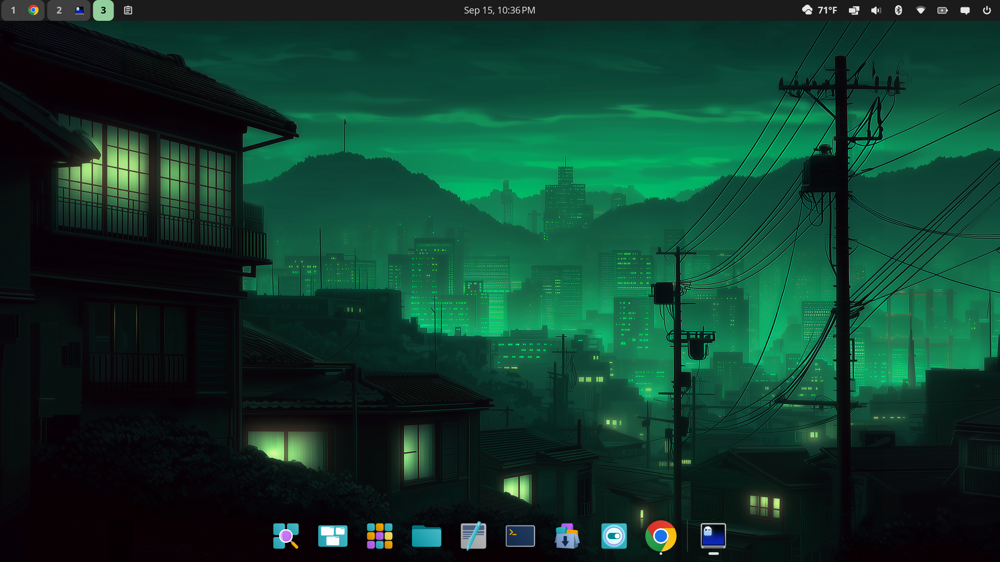
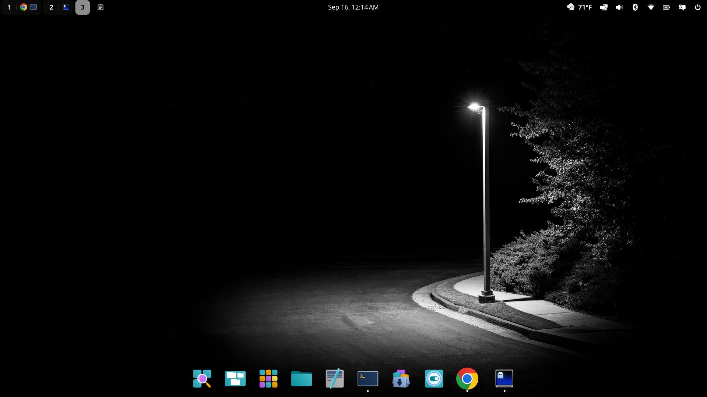
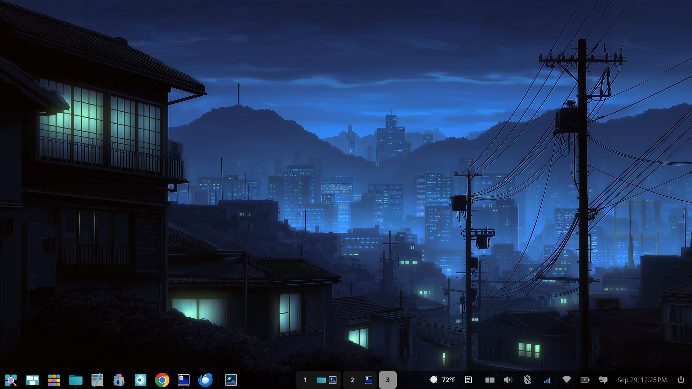
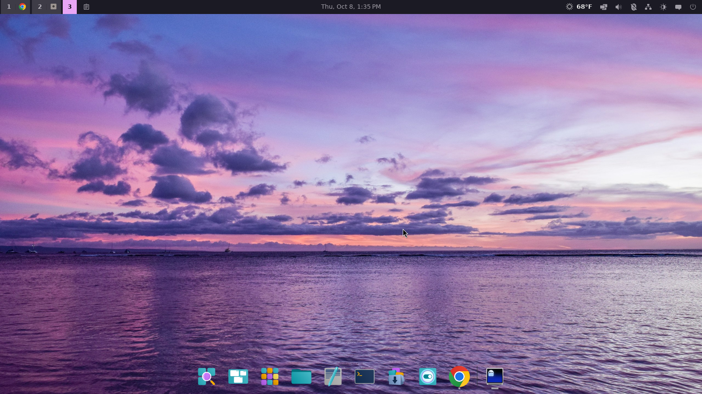
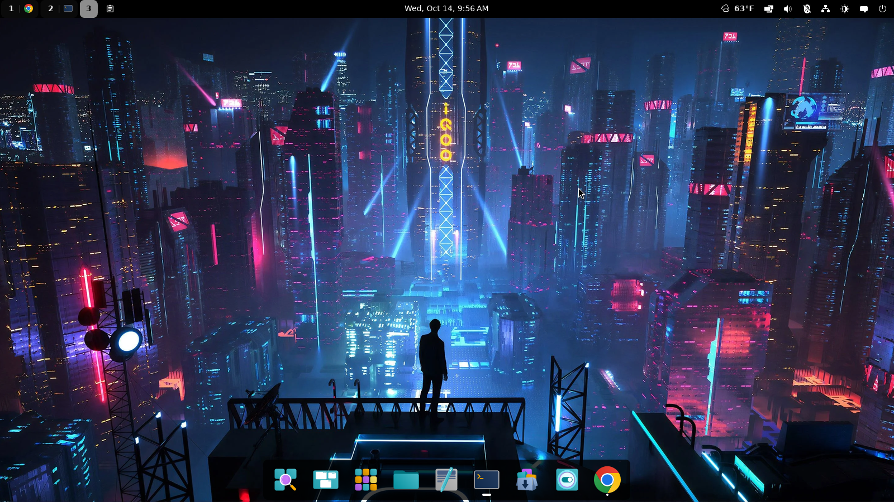

# Cosmic Desktop Customization

Six ready-made looks ("rices") for the [COSMIC](https://system76.com/cosmic)
desktop, and one script that installs or removes any of them.

| Milky Way | Osaka Jade | Onyx | Glowing City | Violet Tide | Downtown |
|---|---|---|---|---|---|
|  |  |  |  |  |  |

| Rice | Look | Changes |
|---|---|---|
| [`milky-way`](rices/milky-way/README.md) | Milky Way wallpaper, blue accent, Yaru theme and icons; made for the Bottom dock only layout | Colors, wallpaper, theme and icons |
| [`osaka-jade`](rices/osaka-jade/README.md) | Green neon city wallpaper, jade accent; made for the Top bar + fixed dock layout | Colors and wallpaper |
| [`onyx`](rices/onyx/README.md) | Pure black with grey accents, dark street wallpaper | Colors and wallpaper only |
| [`glowing-city`](rices/glowing-city/README.md) | Pure black with grey accents, blue neon city wallpaper | Colors and wallpaper only |
| [`violet-tide`](rices/violet-tide/README.md) | Dark slate-purple with a pink-lavender accent, purple sunset-over-water wallpaper, square corners, see-through terminal | Colors, corners, wallpaper and terminal opacity |
| [`downtown`](rices/downtown/README.md) | Near-black with a lavender-blue accent, neon city at night wallpaper, pink-red and gold warnings, square corners | Colors, corners, wallpaper and terminal opacity |

## Requirements

- A working COSMIC desktop on Pop!_OS, Arch Linux or Fedora (COSMIC Spin).
  Any other distro that uses `apt`, `pacman` or `dnf` should work the same
  way.
- `git`, to download this repo.

| Rice | Pop!_OS (`apt`) | Arch (`pacman`) | Fedora (`dnf`) |
|---|---|---|---|
| `milky-way` | tested | tested | not tested |
| `osaka-jade` | tested | tested | tested |
| `onyx` | tested | tested | tested |
| `glowing-city` | tested | tested | not tested |
| `violet-tide` | tested | tested | tested |
| `downtown` | tested | tested | tested |

## Install

### 1. Get the repo

```bash
# Pop!_OS
sudo apt install git

# Arch
sudo pacman -S git

# Fedora
sudo dnf install git
```

```bash
git clone https://github.com/ggregoro/Cosmic-Desktop-Customization.git
cd Cosmic-Desktop-Customization
```

### 2. Install the dark GTK theme (optional)

Older GTK3 apps ignore COSMIC's dark mode and stay light unless the
`adw-gtk3-dark` theme is installed. The rice still applies without it.

```bash
# Arch
sudo pacman -S adw-gtk-theme

# Fedora
sudo dnf install adw-gtk3-theme
```

Pop!_OS has no `apt` package for it. Download the latest `adw-gtk3v*.tar.xz`
from the [adw-gtk3 releases page](https://github.com/lassekongo83/adw-gtk3/releases)
and unpack it into your themes folder:

```bash
mkdir -p ~/.local/share/themes
tar -xf ~/Downloads/adw-gtk3v*.tar.xz -C ~/.local/share/themes
```

GTK3 apps installed as Flatpaks need the Flatpak copy of the theme as well
(any distro):

```bash
flatpak install flathub org.gtk.Gtk3theme.adw-gtk3-dark
```

### 3. Install the extras your rice needs

`milky-way` uses the Yaru theme ([commands](rices/milky-way/README.md#extras)).
`osaka-jade`, `onyx` and `glowing-city` need nothing extra.
[`violet-tide`](rices/violet-tide/README.md#extras) and
[`downtown`](rices/downtown/README.md#extras) have optional terminal
colors to import by hand.

### 4. Apply the rice

```bash
./switch-rice.sh --list
./switch-rice.sh osaka-jade
```

The script:

1. Saves your current COSMIC settings to a dated folder under
   `~/.config/cosmic-backups/`.
2. Copies the rice's wallpaper to `~/Pictures`.
3. Copies the rice's settings into `~/.config/cosmic`.
4. Turns on dark mode and sets the GTK theme (and the icon theme, for
   `milky-way` and `downtown`).
5. Restarts the panel and the wallpaper so the change shows at once.
   Usually no logout is needed, but on Pop!_OS and Fedora some settings
   (such as the accent color, corners or icons) may only show after
   logging out and back in.

Run it again with another name to switch rices. A rice never touches your
panel, dock, applets or pinned apps; for those, see Panel layouts below.

## Panel layouts (optional)

Any rice can be combined with a panel layout. Without one, your panel and
dock stay exactly as they are.

| Layout | What you get |
|---|---|
| `top-bar-autohide-dock` | Top bar + autohide dock: a thin top bar and a dock at the bottom that hides when a window overlaps it |
| `top-bar-fixed-dock` | Top bar + fixed dock: the same top bar, and a dock that always stays on screen; windows stop above it (made for `osaka-jade`) |
| `bottom-dock` | Bottom dock only: no top bar; one dock across the full width holds everything, like KDE (made for `milky-way`) |

Every dock floats a little above the bottom edge. With a top bar the dock
is 75% opaque and normal size; Bottom dock only is 50% opaque and small. The top bar never floats or hides. For other changes, such
as the dock's "Automatically hide" switch, use COSMIC Settings.

Every layout puts the applets in the same order: workspaces, clipboard
and workspace icons on the left, the clock and calendar in the middle, and
weather, tray, tiling, sound, Bluetooth, network, battery, notifications
and power on the right. On the docks the launcher and your pinned apps
follow the workspace icons (Bottom dock only) or sit in the middle of the
dock (the other two). Your pinned apps themselves are never changed.

```bash
./switch-rice.sh milky-way --layout bottom-dock   # rice and layout together
./switch-rice.sh --layout top-bar-fixed-dock      # layout only
./switch-rice.sh --restore                        # undo either
```

A layout replaces the applets on your panel and dock, so `--restore` is the
way back to your own. The clipboard, workspace icons and weather applets
come from Flathub; any that are not installed are simply left out:

```bash
flatpak remote-add --if-not-exists --user flathub https://dl.flathub.org/repo/flathub.flatpakrepo
flatpak install --user flathub io.github.cosmic_utils.cosmic-ext-applet-clipboard-manager
flatpak install --user flathub io.github.crocodile.cosmic-ext-applet-workspace-icons
flatpak install --user flathub com.vintagetechie.CosmicExtAppletTempest
```

On Arch, install Flatpak first with `sudo pacman -S flatpak`.

## Uninstall

Put back the settings you had before the last switch:

```bash
./switch-rice.sh --restore
```

Each switch makes its own backup. The script keeps the oldest one, which
holds your settings from before the first rice, and the newest 10; older
ones in between are removed. To go back further, name the backup folder:

```bash
ls ~/.config/cosmic-backups
./switch-rice.sh --restore 20260101-120000
```

The restore puts back your COSMIC settings, dark-mode setting, GTK theme and
icon theme. It leaves the wallpaper images in `~/Pictures` and any packages
you installed; remove those yourself if you no longer want them. Package
removal commands are in each rice's README.

## Rice picker (optional)

A window for choosing a rice, like Omarchy's theme menu: the rices are
shown as cards with a screenshot; pick one to see it large with what it
changes, then Apply (or Enter, or a double-click; a single click only
shows it). The Layout menu next to Apply picks a
[panel layout](#panel-layouts-optional) to apply with the rice; it starts
on "Keep mine", remembers your last choice, and shows the layout each
rice was made for. "Keep mine" leaves the panel and dock as they are
now, so after trying a layout it does not bring your own back: "Undo last
switch" (`./switch-rice.sh --restore`) does that. It goes back to the
settings from before the last switch and sets the Layout menu back to
"Keep mine". Keys: arrows to move, Enter to apply, Esc to close.

`milky-way` sets the Yaru theme for GTK apps, so the picker window itself
turns Yaru's orange and green while it is applied. Any other rice sets the
dark theme (`adw-gtk3-dark`) back.

It needs GTK 4 for Python:

```bash
# Pop!_OS
sudo apt install python3-gi gir1.2-gtk-4.0

# Arch
sudo pacman -S python-gobject gtk4

# Fedora
sudo dnf install python3-gobject gtk4
```

Then, from the repo folder:

```bash
./rice-picker.py --install    # adds Rice Picker, with its icon, to the app list (Utilities)
./omarchy-keys.sh --apply     # optional: opens it with Super+Shift+Ctrl+Space
./rice-picker.py --remove     # takes it out of the app list again
```

If you installed it before the icon existed, run `--install` again; the
new icon may only show in the App Library and dock after logging out and
back in. `--install` links `~/.local/bin/rice-picker` to this repo, so keep the
repo where it is (or run `--install` again after moving it). The
screenshots are previews: on Pop!_OS and Fedora some parts only show
after logging out and back in, and the picker reminds you.

Tested on Arch Linux (COSMIC), including the Layout menu.

## Omarchy-style keys (optional)

If you also use Omarchy, these add a few of its shortcuts to COSMIC so
the same keys work on both. They work with any rice, or none.

| Key | Opens |
|---|---|
| `Super+Return` | Terminal |
| `Super+Shift+Return` | Web browser |
| `Super+Shift+B` | Web browser |
| `Super+Shift+F` | File manager |
| `Super+Shift+Ctrl+Space` | Rice picker (see below; install it first) |

COSMIC does not use any of these keys, so none of its own shortcuts
change: `Super+T`, `Super+B` and `Super+F` still work as before.

```bash
./omarchy-keys.sh --apply     # add them
./omarchy-keys.sh --remove    # take them away again
```

Any shortcuts you set yourself are kept. If you already use one of
these keys for something else, the script changes nothing and
tells you. `--remove` puts your shortcuts file back as it was, unless
you changed shortcuts in Settings since; then remove the keys there by
hand. If you added the keys before the rice picker key existed,
run `--apply` again to add it. The rice switch and its `--restore` do not touch these
keys. If a key does nothing at first, log out and back in.

Tested on Pop!_OS (with a shortcut of its own already set).

## Troubleshooting

**The panel, dock or wallpaper still shows the old look.** Restart them:

```bash
pkill -x cosmic-panel
pkill -x cosmic-bg
```

COSMIC starts both again within a second. If that does not help, or if only
the window borders are wrong, log out and back in.

**The window border is a different color from the accent.** Every rice
clears a saved window border color so the border follows the accent;
log out and back in for it to show. `--restore` brings your old border
color back.

**A panel applet is missing.** The panel layout lists an applet that is
not installed. Install it (see [Panel layouts](#panel-layouts-optional))
and restart the panel as above.

**Do not delete or move `~/.config/cosmic` while COSMIC is running.** COSMIC
rewrites the folder as you remove it and the result is a mix of old and
default settings. Use `./switch-rice.sh --restore`, which copies files back
in place.

## Wallpaper credits

- `milky-way`: photo by
  [Jeremy Thomas on Unsplash](https://unsplash.com/photos/blue-and-purple-galaxy-digital-wallpaper-E0AHdsENmDg)
  (Unsplash License).
- `osaka-jade`: from the Osaka Jade theme in
  [Omarchy](https://github.com/omacom/omarchy) (MIT License).
- `onyx`: from the [Onyx](https://github.com/ggregoro/onyx) theme.
- `glowing-city`: a blue-tinted edit of the `osaka-jade` wallpaper.
- `violet-tide`: four photos from Unsplash (Unsplash License), by Engin
  Yapici, Artiom Vallat, Loris Boulinguez and Vishnu K R.
- `downtown`: found on WallpaperSafari, artist unknown. If it is yours,
  open an issue and it will be credited or removed, as you prefer.
