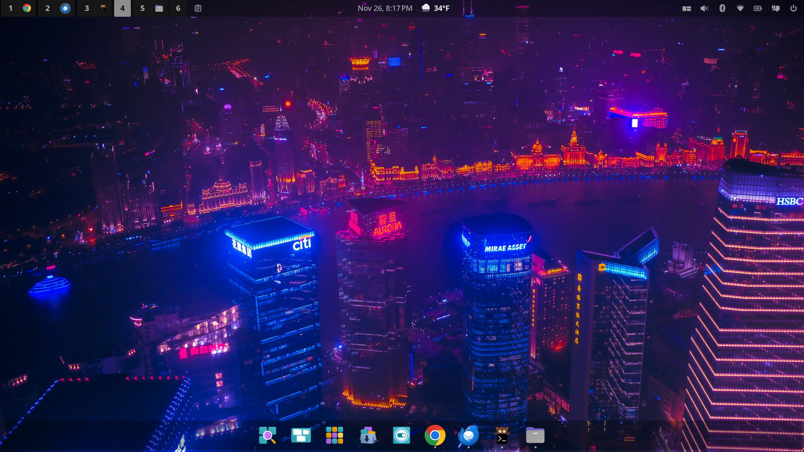

# Downtown



- **Wallpaper:** Shanghai at night from high above: blue-lit towers,
  magenta signs and a gold riverfront under a purple-black sky. Photo by
  [Francois Hoang on Unsplash](https://unsplash.com/photos/high-angle-photography-of-city-during-nighttime-MFYlCoSm-0o)
  (Unsplash License).
- **Colors:** dark mode, near-black background (`#07070C`), warm grey-white
  text, lavender-blue accent (`#7A77BA`); warnings in gold
  (`#F5B13B`), errors in pink-red (`#FF3D6E`). The palette comes from the
  [Downtown](https://github.com/ggregoro/downtown) theme.
- **Corners:** 2 px, on windows and controls (the same in every rice).
- **Icons:** Yaru in its purple, dark-mode version (`Yaru-purple-dark`),
  so folders match the lavender accent. Needs Yaru installed (see
  below); without it your icons stay as they are.
- **Terminal:** COSMIC Terminal at 90% opacity.
- **Layout:** unchanged. This rice sets colors, corners, wallpaper,
  icons and terminal opacity only, so your panel and dock stay as they are.

The color shades were worked out by script from the palette, not
produced by COSMIC. To have COSMIC work them out itself, open Settings >
Desktop > Appearance after applying and pick the accent color once.

Tested on Arch Linux, Pop!_OS and Fedora 44. On Arch everything shows at
once. On Pop!_OS and Fedora some parts (on Pop!_OS the accent color,
corners and wallpaper; on Fedora the icons) only appeared after logging
out and back in, so do that if the look does not change at once.

The border around the active window follows the accent. If you had
picked your own window border color before, the rice clears it (in the
first Pop!_OS test, a saved light blue border survived the rice; fixed
since).

The solid purple folders need Yaru 26.04 or newer (Arch has it). With
older Yaru, such as 25.10 on Fedora 44, the folders are grey with a
purple flap at the back.

## Extras

**Terminal colors** (optional). The rice does not change COSMIC
Terminal's text colors. To use the Downtown ones, open COSMIC
Terminal, choose View > Color schemes > Import, and pick
`rices/downtown/extras/downtown-terminal.ron`. Then select
"Downtown" in the list. Tested on Fedora 44.

## Install

**Yaru icons** (for the purple folders):

```bash
# Pop!_OS
sudo apt install yaru-theme-icon

# Arch (from the AUR, so an AUR helper such as yay is needed)
yay -S yaru-icon-theme

# Fedora
sudo dnf install yaru-icon-theme
```

Then, from the repo folder (see the [main README](../../README.md#install) for the
full steps):

```bash
./switch-rice.sh downtown
```

## Uninstall

```bash
./switch-rice.sh --restore
```
