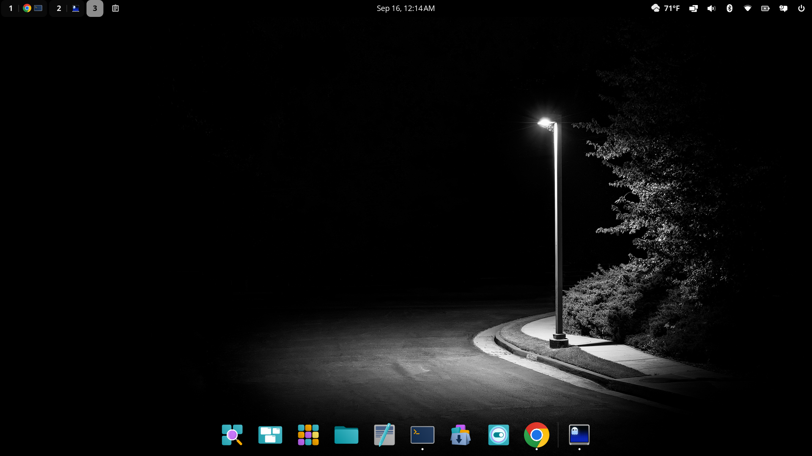

# Onyx



- **Wallpaper:** a dark street lit by one lamp.
- **Colors:** dark mode, pure black background, white text, purple accent
  (`#7A77BA`, the same as Downtown). The rest of the palette comes from the
  [Onyx](https://github.com/ggregoro/onyx) theme.
- **Layout:** unchanged. This rice sets colors and wallpaper only, so your
  panel and dock stay as they are.

The color shades were written by hand, not produced by COSMIC; the purple
accent shades are Downtown's. To have COSMIC work them out itself, open
Settings > Desktop > Appearance after applying and pick the accent color
once. [`glowing-city`](../glowing-city/README.md) is the same palette with a
grey accent (`#8D8D8D`) and COSMIC's own shades.

Tested on Pop!_OS, Fedora (COSMIC Spin) and Arch Linux.

## Extras

None.

## Install

From the repo folder (see the [main README](../../README.md#install) for the
full steps):

```bash
./switch-rice.sh onyx
```

## Uninstall

```bash
./switch-rice.sh --restore
```
